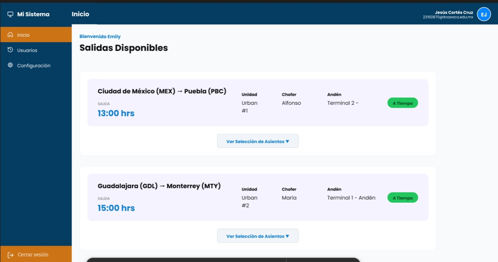
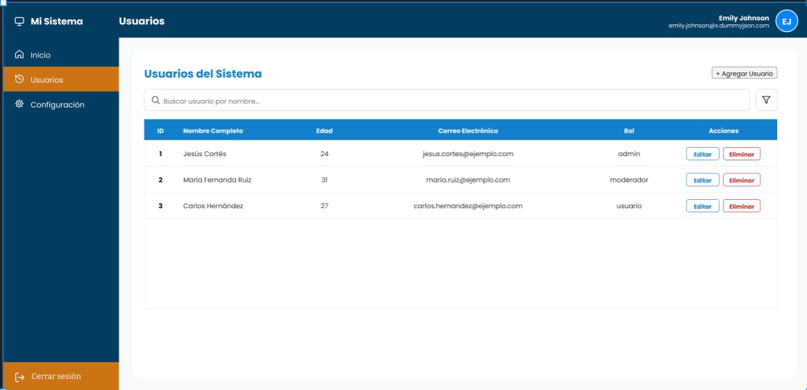
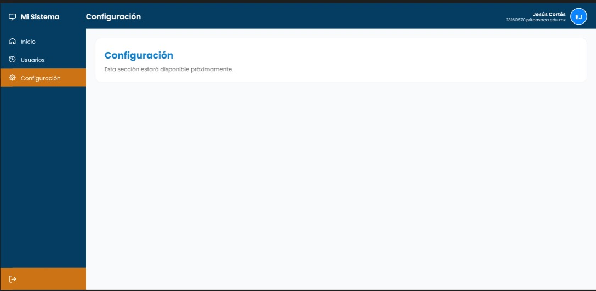

# t3_act8_eq05

Actividad 8 - Tema 3
Equipo 05

## Integrantes

- Nombre Cortés Cruz Jesús
- Nombre Cruz Santiago Roque Antonio 

## APIs utilizadas

Fase 1 (Login):
- POST https://dummyjson.com/auth/login
- Los usuarios y contraseñas de prueba se consultan en: https://dummyjson.com/users

Fase 3 (Tabla de datos):
- DummyJSON Usuarios: https://dummyjson.com/users

## Proyecto desplegado

https://t3act8eq05.eastus.cloudapp.azure.com/t3_act8_eq05/

en algunos navegadores aveces es forzado a usar el http"S" es necesario quitar la S
Usuario de prueba para entrar:

- Usuario: emilys
- Contraseña: emilyspass

## Tecnologías

- React
- Vite
- API de DummyJSON
- Despliegue con Nginx en un VPS

## Capturas

### Login

### Pantalla de Inicio

### Pantalla con Tabla de Usuarios

### Pantalla Adicional
